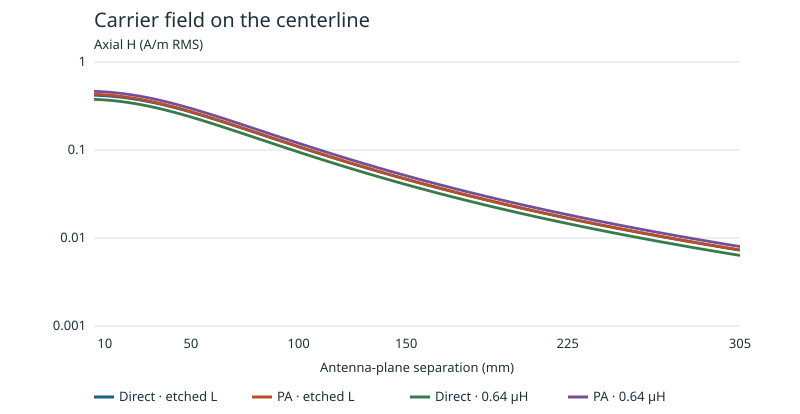
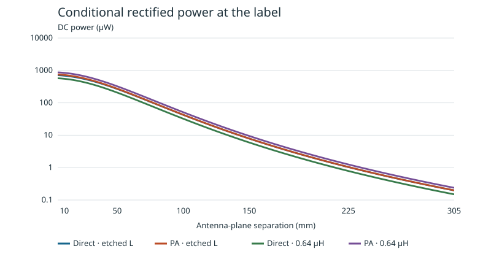
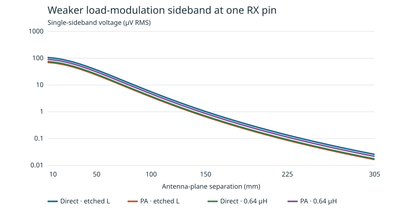
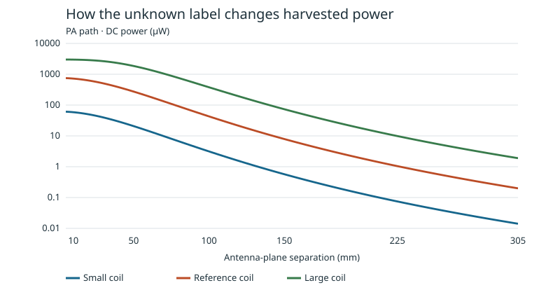

# Rev A3 operating range with the Santek 2.9-inch label

**A complete refresh at 305 mm is not a credible fabrication assumption for Rev A3.** On the primary port, the centered free-space model gives about **0.0073 A/m RMS at 305 mm** in either patch configuration. A plausible, explicitly hypothetical label converts this into **0.20 µW DC**; its weaker reply sideband at one PN5180 input is **26 nV direct or 16 nV amplified**. Even the larger, more efficient label scenario in this study yields only 1.9 µW there. The Santek sources reviewed give no winding data, cold-start requirement, refresh power or reply amplitude for the exact label. **The maximum successful refresh distance is unknown.**

For a decision nearer the panel, suppose the reference label needs **0.5 mW continuously** and reliable decoding needs **10 µV RMS per pin on the weaker sideband**. The calculated upper separation is **28 mm direct or 30 mm amplified**. If the same label instead needs **0.1 mW**, the limits become **77 mm direct or 72 mm amplified**. At **1 mW**, neither path reaches that threshold anywhere in the 5–305 mm scan. These are conditional crossings, not performance claims for the Santek unit. A measured stage threshold or a camera-confirmed close-range test would change the estimate far more than refining the cable loss.

**Source and evidence.** Analyzed [PR #10](https://github.com/Liberty-Chris/trXb5/pull/10) at [e402a3b4317efa9d55081e0cc4e0043a2dddca39](https://github.com/Liberty-Chris/trXb5/commit/e402a3b4317efa9d55081e0cc4e0043a2dddca39). Its exported hardware is pinned to [1c3d24eae38d962c571f17d69f5a6a13c1a7a93a](https://github.com/Liberty-Chris/trXb5/commit/1c3d24eae38d962c571f17d69f5a6a13c1a7a93a). Design facts come from the native nets, routed layers and populated BOMs. All numerical link results here are frequency-domain calculations or parameter sweeps. There are **zero A3 hardware or exact-label range measurements** in this analysis. [Inputs, citations and uncertainty](PARAMETERS.md) · [A3 commissioning limits](../../validation/COMMISSION_A3.md)

## Power from reader to loop

The calculation uses the first selector port, 1.00 m of 50 Ω coax to the panel, 0.15 m for each patch, an isolated free-space panel, 23 °C, centered parallel antenna planes and an uninterrupted steady carrier. The reference setting is 90% of the ideal 3.3 V differential square-wave fundamental. Both J201 and the selected source's output are held to the initial 25 mW forward target. The reference case fits that target at every listed distance. All values below refer to the fundamental. The source's all-harmonics bound is a separate calculation.

**Direct.** From TX1/TX2 the odd-mode model sees 66 Ω external series resistance, two 470 nH chokes in series, the two 68 pF grounded capacitors as 34 pF differential shunt, the two 300 pF capacitors as 150 pF differential series, and 160 pF across T201. Its 1:1 secondary drives the first K200 contact and J201. A cold-installed jumper leads to J202, the common bus, K301 and J301. K200's second contact simultaneously feeds T202. The pickup is a shunt branch on both paths. R106 is a supply bleed; it affects the rail and thermal margin, rather than adding a third 33 Ω in the RF path. [Reader sheet](../../../hardware/controller/RevA3/Reader.kicad_sch) · [RF matching](../../../hardware/controller/RevA3/RF_match.kicad_sch) · [Disconnect](../../../hardware/controller/RevA3/RF_disconnect.kicad_sch) · [Primary selector](../../../hardware/controller/RevA3/Ports_0_2.kicad_sch)

With source amplitude ±V, the RMS fundamental of an ideal complementary square wave is 2√2 V/π. The nominal Thevenin source is 2.674 V RMS behind 70 Ω including assumed driver resistance: **25.5 mW available** to a conjugate match. After the network, the J201 equivalent is 1.697 V open circuit behind 33.30 − j47.14 Ω: **21.63 mW available**. A fixed 50 Ω load extracts less. At the most favorable documented 3.45 V RMS all-harmonics bound and two minimum-value 33 Ω resistors, the passive network can receive no more than 45.54 mW total; even an ideal full square under that rail has at most 36.91 mW available at the fundamental before the network. Neither number is panel power.

**Amplified.** Patch J201→J210 and J211→J202. The PA adds a separately powered output. C214 and the two 24.9 Ω resistors present about 49.8 − j1.17 Ω and halve the voltage reaching +IN. Closed-loop gain is 1+(649+100)/187 = 5.005. R214 and a matched load halve the result again. Matched voltage gain from J210 to load is about **1.25**, or **1.57× power**. Nominal on-board J210 drive is **0.874 V RMS**. The model produces **24.1 mW forward at J211** for the distant label. At full ideal drive on 3.3 V it predicts 0.971 V at J210 and ~29.8 mW forward; the latter exceeds the initial 25 mW setting and is a reachability calculation only. Across 32 full-drive combinations of rail, driver R, choke Q and matching tolerances, J210 spans **0.823–1.083 V RMS**, with **21.4–37.0 mW** at J211 before commissioning backoff. Actual settings, enclosure temperature and waveform can reduce these figures. [Native PA](../../../hardware/controller/RevA3/Linear_PA.kicad_sch) · [Drive corners](drive-corners.csv)

**The 85 mW stop is unreachable into a matched 50 Ω load at nominal gain within the 1.50 V RMS input limit.** It would require about **1.65 V RMS** at J210. Even externally imposing the 1.50 V maximum would produce about **70.6 mW** into a match, and a 1%-resistor favorable corner still gives less than 76 mW. The modeled on-board source falls further short. At nominal drive the amplifier output before ballast is only about 2.2 V RMS (≈3.1 V peak about MID, ≈265 V/µs). The input pad, output ballast and available reader drive dominate this calculation. The THS3491's headline voltage/current/slew ratings do not authorize more RF drive; supply edge, oscillation, peak swing, thermal and mismatch tests still apply. [TI datasheet](https://www.ti.com/lit/ds/symlink/ths3491.pdf) · [Documented envelope](../../validation/REV_A2.md)

| Mode at 305 mm | J201 forward / reflected | Final source forward / reflected | Panel forward / reflected | Panel accepted | Loop RMS |
|---|---:|---:|---:|---:|---:|
| Direct, geometry L | 23.98 / 3.20 mW | Same J201 | 22.38 / 4.41 mW | 17.98 mW | 74.0 mA |
| PA, geometry L | 15.53 / 0.002 mW | J211 24.11 / 3.22 mW | 22.51 / 4.43 mW | 18.08 mW | 74.2 mA |
| Direct, release-example L | 15.02 / 0.033 mW | Same J201 | 13.53 / <0.001 mW | 13.53 mW | 64.4 mA |
| PA, release-example L | 15.53 / 0.002 mW | J211 23.89 / <0.001 mW | 21.52 / <0.001 mW | 21.52 mW | 81.2 mA |

Forward and reflected powers use the **same 50 Ω reference plane**: P± = |V ± 50 I|²/200 for RMS phasors. Their difference is accepted real power. With this reactive direct source the forward reading can exceed conjugate-available power while the **net** reading respects that bound. A coarse mismatch can coincidentally deliver more current from the direct source than a 50 Ω match. That does not improve the PA match or establish broadband operation.

In the geometry case at 305 mm, R104/R105 dissipate **36.8 mW direct** and **55.6 mW with the PA input connected**. The chokes lose 1.28/1.93 mW and T201 loses 1.93/1.12 mW, respectively. In the PA path its input pad uses 15.31 mW and R214 dissipates 25.46 mW from the powered output. The panel coax loses 1.26 mW and K301 contact resistance about 0.063 mW in that path. At the panel, **12.11 mW goes to R401**, 5.51 mW to assumed conductor/feed loss and 0.45 mW to capacitor banks. The secondary takes 0.995 µW RF including its winding loss; only 0.199 µW becomes load DC. At 10 mm its reflected RF resistance rises from 0.00018 Ω to 0.802 Ω and changes the loop current. [Per-part power accounting](losses.csv)

## Etched loop, tuning and label coupling

The 150 × 150 mm outline surrounds **one 140 mm centerline turn**. The solver reads the nine straight and chamfered copper segments from the native PCB. It closes the feed through the dominant component locations; actual capacitor current divides among six parts. Finite straight-segment Biot–Savart gives the vector field, then 8 × 8 Gaussian quadrature integrates its normal component across the tilted finite label winding. Mutual inductance is M = μ₀ N ∫(H/I)·n dA. It is not calculated from display diagonal or by applying a far-field antenna gain. At 305 mm the wavelength is about 22 m, so these dimensions support a magnetoquasistatic free-space model. [Geometry and reproducible integration](geometry.py)

Summing signed Neumann mutual terms and regularized strip self terms gives **0.552 µH** with a straight 12 mm gap closure and **0.564 µH** with a routed feed closure. At 305 mm these give 0.464 and 0.460 nH mutual inductance for the reference label. HF currents, bank current splitting, ferrite and nearby structures can shift the effective inductance. For the geometry case, the lossless starting match at R=3.2 Ω wants **328 pF series**. The fitted series maximum is **299 pF nominal**. The best attainable unloaded reflection over a 1 pF grid uses both trimmers at 40 pF, giving 20.45 + j11.41 Ω at the panel. For the 0.640 µH release example the optimum is 19 pF series trim and 8 pF shunt trim, giving 49.63 − j0.99 Ω. Both cases use the delivered components. A bare-loop VNA measurement would distinguish them. [Existing installed-panel model](../../../software/panel_match.py) · [A3 engineering review](../../validation/REV_A3.md)

The reference label is a **hypothesis**: three 50 × 25 mm mean turns, 1.5 µH tuned to carrier, unloaded Q 30 (coil loss 4.26 Ω), an equivalent 4.26 Ω RF load, and 40% conversion from RF load power to DC. For each separation the solver reflects (ωM)²/Z₂ into the panel branch, recalculates current from the actual source, and obtains I₂ = −jωMI₁/Z₂ and Pdc = η |I₂|² Rload. Equal coil and load resistance is favorable for harvesting; a voltage-dependent rectifier can be less efficient or fail to start altogether. From 10 to 305 mm, coupling k falls from 0.0334 to 0.000501. The open-circuit induced emf at 305 mm is only **2.9 mV RMS** before resonant voltage transformation. Exact startup also depends on tag tuning, rectifier topology and reservoir state.

### Centered free space, reference label

For example, a simple parallel-tuned harvester with loaded Q≈15 would develop only about 44 mV RMS (62 mV peak) across its tank at 305 mm. At 10 mm the same linear estimate is about 2.6 V RMS; rectifier loading or regulation could then be strong. These illustrate why cold start and efficiency cannot be assumed constant. The tabulated sidebands require a powered, responding label. If it stays in brownout, the reply is absent.

Paired entries are **direct / PA**. H is local axial field at the geometric center of the label plane. M already integrates the field over the label area. Reply is the **weaker of the two single sidebands**, RMS at one IC input. All distances are winding-plane to winding-plane. [Full precision, both L scenarios and both sidebands](distance.csv)

| Gap mm | M nH | Loop mA | H A/m | Harvested µW DC | Reply µV per pin |
|---:|---:|---:|---:|---:|---:|
| 10 | 30.68 | 65.5 / 67.2 | 0.414 / 0.424 | 689 / 723 | 102 / 67.0 |
| 25 | 26.55 | 67.5 / 68.8 | 0.375 / 0.382 | 547 / 569 | 78.6 / 51.2 |
| 50 | 17.68 | 71.0 / 71.7 | 0.270 / 0.273 | 268 / 274 | 36.5 / 23.6 |
| 75 | 10.94 | 72.8 / 73.2 | 0.173 / 0.174 | 108 / 109 | 14.3 / 9.18 |
| 100 | 6.80 | 73.5 / 73.8 | 0.109 / 0.109 | 42.6 / 42.9 | 5.57 / 3.57 |
| 150 | 2.90 | 73.9 / 74.1 | 0.0465 / 0.0466 | 7.86 / 7.90 | 1.02 / 0.655 |
| 225 | 1.06 | 74.0 / 74.2 | 0.0168 / 0.0168 | 1.04 / 1.04 | 0.135 / 0.0865 |
| 305 | 0.460 | 74.0 / 74.2 | 0.00728 / 0.00730 | 0.198 / 0.199 | 0.0257 / 0.0165 |




## Power, replies and refresh are separate tests

The manufacturer's manual explicitly identifies **SE0290C1** and gives approximately **25 seconds for a full refresh**. Its product page gives approximately **30 seconds per update**. Use observed completion and the project's 30 s minimum hold; neither nominal time establishes the physical unit's worst-case dwell. The manual confirms NFC-powered rewriting and flags interference from nearby metal and magnetic materials. Its dimensioned drawing provides housing and active-display dimensions only. [Santek manual, pp. 4 and 15](https://cdn.shopify.com/s/files/1/0276/2024/5581/files/EZ-Sign-User-Manual-Eng_compressed.pdf?v=1769634055)

Santek specifies an NFC-powered 296 × 128 four-color product, roughly 30 s per update, with the reader held steady over the back. It does not supply a phase-specific RF-to-DC requirement for this unit. The observed FMSC marking, recovered PC/SC application and independent PN5180 EZ Sign implementation support the protocol investigation; they do not determine coil turns, chip model, power or load modulation. A comparable Good Display FM1280 development board lists ≤15 mW refresh power for supported displays. It supplies a useful high end for a sensitivity sweep, not a Santek threshold. [Santek product and use instructions](https://santekdisplay.com/en/products/ez-sign-nfc-e-paper-display-4-color) · [Good Display board](https://www.good-display.com/product/561.html) · [Protocol evidence](../../research/PROTOCOL.md)

| Conditional gate, with continuous carrier | Assumed DC during stage | Assumed weaker-sideband requirement | Passing separation direct / PA |
|---|---:|---:|---:|
| Power-on and identification reply | 10 µW | 1 µV | 5–142 / 5–136 mm |
| Image transfer with repeated acknowledged blocks | 100 µW | 10 µV | 5–77 / 5–72 mm |
| Complete, 30 s refresh plus final status | 500 µW | 10 µV | 5–28 / 5–30 mm |
| Same refresh with a higher demand | 1 mW | 10 µV | No passing sample in either 5–305 mm sweep |

At 50 mm the reference winding converts illustrative 10, 100, 500 and 1,000 µW DC requirements into approximately **0.052, 0.165, 0.368 and 0.52 A/m RMS** centerline field respectively. These are inverse calculations at fixed geometry and rectifier efficiency. They provide field-probe targets for a comparison with the commercial reader. For intermittent refresh peaks, the useful reservoir energy between two voltage limits is ½C(Vhigh²−Vbrownout²). Compare that energy with the time integral of demand minus harvested power over each deficit interval as well as the full refresh.

These are examples of **joint** thresholds, sampled every millimeter, with fixed tuning. They assume the tag can start and that its reservoir sustains the PAUSEs intrinsic to Type A downlink modulation. They also assume successful waveform timing, APDUs and a visible refresh. At 305 mm the modeled energy in 30 s is ~6 µJ; a 0.5 mW refresh would need 15 mJ, apart from startup and transfer. A reservoir can supply brief peaks; without its capacitance, regulated minimum voltage and initial charge, accumulation time and brownout margin are unknown. Hold the **same** antenna energized throughout transfer, refresh command, observed busy, minimum hold and repeated idle. Require the camera to confirm the new raster. [All threshold intersections](thresholds.csv) · [Factory-preserving workflow](../../validation/COMMISSION_A3.md)

**Return path.** The selected bus samples the actual carrier and reply through K200, R201/R202 and T202. Its floating secondary drives 4.7 kΩ and 1 nF in each arm into the PN5180 and its antiparallel clamps. At 13.56 MHz the reference model's single-pin voltage gain from the bus is 0.076. At 305 mm it predicts ~0.087 V RMS (0.246 Vpp) per pin in either patch. NXP calls for 1.5–1.65 V RX input level for best sensitivity and documents AGC, clipping and RX_WAIT. The predicted swing is well below that guidance even as peak-to-peak. A low carrier level, insufficient modulation, AGC saturation, carrier phase noise or recovery from the reader’s own modulation can prevent decoding even when sufficient DC reaches the label. An input swing target does not specify the minimum decodable sideband. [NXP §11.8.9 and table 139](https://www.nxp.com/docs/en/data-sheet/PN5180A0XX_C3_C4.pdf) · [NXP AN11740 §4.5.1](https://community.nxp.com/pwmxy87654/attachments/pwmxy87654/nfc/10361/1/AN11740_PN5180%20antenna%20design.pdf?inline=true)

For the return simulation the tag's equivalent load toggles ±10% at fc/16. First-order mixing supplies a secondary series voltage I₂ × 2mRload/π at each of 12.7125 and 14.4075 MHz. The solver propagates it back through the tag impedance at that frequency, jωsM, the loaded panel, coax, bus source impedance and pickup filter. The PA drives the bus through R214 and does not amplify the upstream reply. The return voltage scales approximately as I₁M² in weak coupling. In the forward direction the modeled geometry-panel loop current at the two sidebands is −2.62/−3.14 dB relative to carrier for direct and −3.58/−0.39 dB for PA. The tag adds its own filtering (loaded Q ≈15); treating the carrier tune alone as adequate would miss both attenuation and asymmetry. [Forward bandwidth](bandwidth.csv) · [Circuit and mixing solver](network.py)



At 305 mm the nominal receiver would need to discriminate a sideband about 131–134 dB below its pin carrier. As a scale check, one 4.7 kΩ resistor at 296 K has 2.77 µV RMS open-circuit Johnson noise in a hypothetical 100 kHz noise bandwidth; the nominal pin divider passes about 0.48 µV of that per arm. Actual bandwidth, differential combining, coding gain, noise figure and interference require measurement. This is not an IC sensitivity specification. Inspect carrier envelope/ring-down, clamps, AGC value, RX_WAIT, first ATQA after REQA and first response after a modulated image frame. Lower AGC resistance or weaker tag switching reduces reply further. At the 100 µW/10 µV gate the direct path is power-limited and the PA path is reply-limited. At the 500 µW gate both are power-limited. The controlling gate on the physical label cannot be identified from the schematic alone.

## What 305 mm would require

Holding the reference label parameters fixed, invert the coupling equation at the actual gap. The following are **counterfactual requirements**, mathematically extrapolated beyond the board's operating envelope; they are not amplifier selections or permissible test settings. Panel accepted power includes the modeled winding, R401 and both banks. H below is the centerline field appropriate to this geometry.

| Required continuous DC | Required loop RMS | Required H RMS | Required panel accepted | R401 alone |
|---:|---:|---:|---:|---:|
| 10 µW | 0.526 A | 0.0518 A/m | 0.909 W | 0.609 W |
| 100 µW | 1.66 A | 0.164 A/m | 9.09 W | 6.09 W |
| 1 mW | 5.26 A | 0.518 A/m | 90.9 W | 60.9 W |

Even surrendering **all 85 mW** to just the nominal 3.2 Ω loop-plus-damping resistance, with zero upstream loss and perfect matching, would give only **0.163 A RMS and 0.96 µW DC** at 305 mm for this tag. With only R401's 2.2 Ω known, the corresponding absolute current bound from the forward-power stop is 0.197 A. R401 is a 250 mW component. The actual ~74 mA link needs a label that can finish on ~0.2 µW and a receiver that can decode tens of nanovolts in the assumed modulation case. The combination of small mutual inductance, limited carrier drive, fixed damping and the two-way reply path is the obstacle. [Required-current sweep](required-305.csv)

## Sensitivity to installation and label

- **Unknown antenna and harvester dominate.** At 50 mm the small/reference/large hypothetical receiver coils yield 21/274/1,853 µW on the PA path. At 305 mm the same cases yield 0.014/0.199/1.89 µW. A 5% upward shift in reference-label resonance reduces the 50 mm result to 87 µW. An unknown ferrite backer can change aperture, loss and resonance together. These three curves are scenarios, not statistical confidence limits.
- **Placement matters.** At 50 mm a 50 mm lateral offset reduces 274 to 157 µW; a centered 45° tilt gives 142 µW. A centered 90° rotation is close to a flux null. Near the conductor use finite-area integration; a universal cosine or inverse-cube correction fails there. Distances exclude packaging and fixture clearance.
- **Component and cable variation.** At 50 mm with trim settings frozen, common −5%/+5% fixed-cap extremes yield 212/317 µW on PA. Varying trim Q from 20 to 200 at 13.56 MHz gives 259–276 µW. Setting effective loop resistance to 0.25/2 Ω gives 334/216 µW. The sweep also covers independent bank errors, reader filter tolerances, cable length, stubs, relay/launch excess loss, diode loading and AGC. At the best geometric tune both trim controls hit their high stops. This is a reason to measure L and S11 before fabrication expenditure. [Sensitivity cases](sensitivity.csv)



**Metal cavity.** A 457 mm metal enclosure is electrically small at the carrier but permits eddy currents, reactive field cancellation and detuning. For illustration only, an infinite perfect conducting plane parallel to and 10 mm behind the panel creates an opposite image loop. With the *same imposed current*, the reference label at 305 mm then has 0.163 of the free-space M and 0.027 of its power. At a 30 mm wall spacing the corresponding factors are 0.398 and 0.158. Finite walls, seams, losses, ferrite, product metal and different orientations can alter that result substantially. Separately, the real input impedance changes the current. Do not apply a universal metal loss in dB. Use measured mounted S11/Q and field maps, or a frequency-domain EM model with conductivity, ferrite complex permeability, geometry and gaps validated on a fixture. [Image-plane sweep](wall-image.csv)

**Four inactive panels.** A reset selector terminates the coax in 49.9 Ω; its remote etched loop remains magnetically coupled. For equally oriented modeled panels, independent k=0.05 coupling to each, and a matched return line, each inactive branch sees roughly 6.30 − j3.09 Ω through its own tuned network. The four reflected terms together add 2.96 + j1.45 Ω at carrier. Without retuning the active panel, predicted 50 mm PA harvest drops from 274 to 153 µW. This isolates changes in drive current. The reradiated fields can also add or cancel at the label; cross-coupling among inactive panels, wall currents, cable common mode and relay electrical leakage require a measured multiport matrix or a coupled EM/circuit solution. Measure each unused termination and pickup with installed lengths. Keep one selected port through the refresh. [Inactive-panel sweep](sensitivity.csv) · [A3 selector requirements](../../REQUIREMENTS.md)

## Smallest pre-fabrication decision test

1. **Measure this label with the known-compatible reader first.** Use the Santek-recommended Sony RC-S300 and Windows app, or an already verified PC/SC writer. Fix the actual unit and reader parallel on a nonconductive spacer jig. Start at contact, then step gap in 5–10 mm increments to bracket failure and repeat at least three times around the boundary. Reset to a known discharged state between trials. Log model/ID, orientation, cold-start success, block acknowledgements when available, busy/idle, dwell, failure stage and a photograph of the changed four-color raster. Keep the factory waveform/configuration. Do not count “card present” or an app success dialog as the endpoint. [Vendor reader recommendation](https://www.santekshop.com/pages/faqs) · [Reference workflow](../../research/VENDOR-PAYLOAD.md)
2. **Measure the field and reply at that boundary.** At the label plane substitute a calibrated small pickup loop and de-embed its cable and termination. For an electrically small open-circuit probe, H = Voc/(ωμ₀NA); calibrate its transfer into the actual scope/analyzer. Map several points over the label aperture; check loaded field using a weak adjacent probe. Record minimum carrier during a whole refresh and both load-modulation sidebands, with reader-only carrier/noise baseline, stated RBW and a time gate over the first/weakest reply. Vary drive at fixed spacing if a compatible fixture permits it. This gives separate successful-field and detectable-reply benchmarks without opening the label. Reference-reader gap alone does not transfer to the A3 coil.
3. **Bridge that result to A3 cheaply.** Make a passive copper-tape or spare-PCB coupon matching the 140 mm winding, banks and R401. VNA-measure L/R, S11 across both sidebands and loop-current/probe transfer with 1 m coax in air. A generator and directional coupler can characterize the field at the modeled accepted power; a plain CW generator cannot demonstrate a protocol refresh. Repeat at cavity wall spacing with ferrite, stock and four terminated panels. Compare the measured successful label field across its aperture with the **measured coupon field at allowed current**. Use a calibrated switched-load emulator or known-label reply capture to check the candidate PN5180 pickup margin. If the field is marginal, the release cannot justify fabrication for range. If it clears both gates, the final proof still requires the actual A3 board, first-response recovery and a camera-confirmed refresh.
4. **Compare the moving-reader option on the same jig.** Move the compatible reader to the measured successful gap, then immobilize it for the full transfer and refresh. Record approach clearance and orientation, positioning repeatability, cable flex, dwell, travel time and success rate in the real cavity. Compare that cycle time and access with fixed-panel success at the worst product position. A moving reader trades the long RF gap for mechanical access and dwell; it remains an alternative pending this comparison.

## Reproduction

From the repository root, use Python 3.10+ with the standard library. The commands write or verify only the model's four SVG plots and eight CSV tables in this directory.

```sh
python docs/analysis/rev-a3-range/analyze.py
python docs/analysis/rev-a3-range/analyze.py --check
python tools/release_a3.py verify
```

The first two commands cover the analytic square-loop cross-check, independent Neumann perimeter versus Biot–Savart flux integration at all eight gaps (relative agreement within one part per million), small-aperture flux, orientation null, drive scaling, zero coupling, real-power conservation and generated results. The last command independently verifies the pre-existing fabrication manifest. None exercises a physical RF link. Model boundaries include a linear carrier, ideal feedback amplifier, lumped tag rectifier and first-order modulation. Thermal evolution, PA recovery, nonlinear startup and installed EM behavior require bench measurements.
